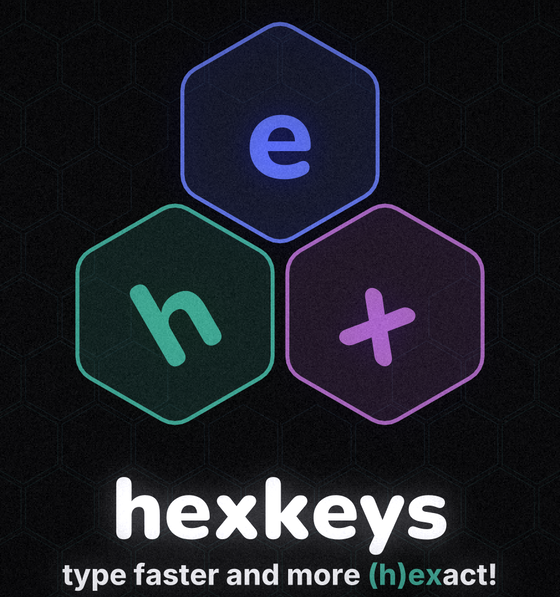
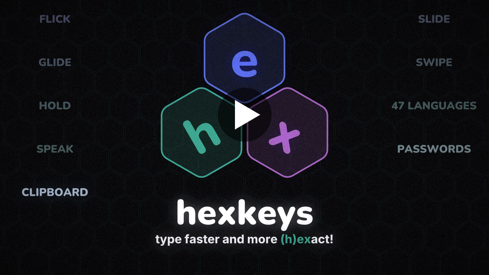
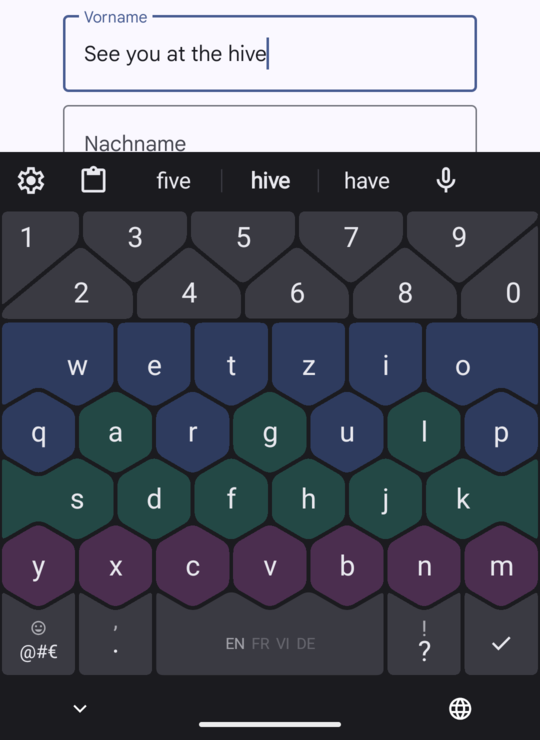
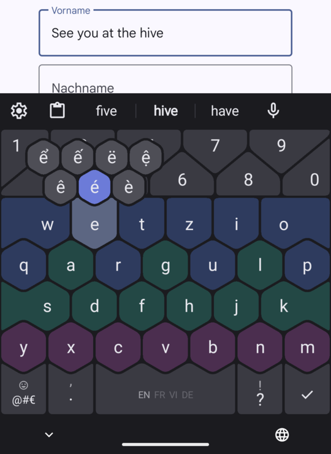

<p align="center">
  
</p>

<p align="center">
  A keyboard for Android with big hexagonal keys, gestures instead of extra keys, and everything a keyboard is expected to do.
</p>

<p align="center">
  <a href="https://github.com/nanbiz/hexkeys/releases/latest"></a>
  <a href="https://github.com/nanbiz/hexkeys/actions/workflows/ci.yml"></a>
  <a href="LICENSE"></a>
  
</p>

<p align="center">
  <a href="https://youtu.be/4kL6td_JMsM"></a>
</p>

## Why hexagons

Hexagons tile a surface with no gaps, so every key can be as large as the screen allows. hexkeys uses that room: seven and six keys per row, letters kept in their familiar QWERTZ order, and no keys that only exist to switch modes.

<p align="center">
  
  &nbsp;&nbsp;
  
</p>

## Gestures

| Gesture | What it does |
|---|---|
| Flick up on a letter | Types its capital |
| Slide in from the right on the number row | Deletes as you slide, faster the further you go; rest at the far side to delete whole words |
| Slide along the middle of the number row | Moves the cursor, one character per step |
| Swipe across the letters | Types the word the path spells |
| Hold a letter | Opens the accented letters your languages use, as a small honeycomb |
| Flick up on `.` or `?` | Types `,` or `!` |
| Flick up on enter | Runs the field's action, such as send or search |
| Flick up on `@#€` | Opens emoji |
| Flick sideways on space | Switches the language |

## Features

- **Suggestions** for every typed word, with the next word predicted after a space. Autocorrect and learning new words are off by default and one switch away.
- **47 languages** from 53 downloadable dictionaries. The keyboard guesses the language from what you write and shows it on the space bar. Vietnamese types with Telex.
- **Dictation** that runs on the phone with NVIDIA's Parakeet model in 25 European languages, writing each stretch of speech while you keep talking.
- **Passwords** from your autofill service as chips in the suggestion strip, with the service's own button pinned in a fixed place.
- **Clipboard**: what you just copied waits in the strip for a one-tap paste; clips stay an hour, or for good once pinned.
- **Emoji** with search by name in every language you use.
- **Themes**: Dusk, Paper, Ember, your device's colours, plain dark and plain light. The starter themes colour each letter by its QWERTZ row, so rearranged letters stay easy to find.
- **Two layouts**: space at the bottom (the default) or space in the middle.

## Privacy

hexkeys has no account, no ads and no trackers. It uses the network only to download the dictionaries, word statistics and speech model you ask for; everything you type and say stays on the phone.

## Install

Download the APK from the [latest release](https://github.com/nanbiz/hexkeys/releases/latest), open it on your phone, then turn hexkeys on under **Settings › System › Keyboard**. Android 9 or newer.

## Build

The core is written in Rust and the Android shell in Kotlin. You need Rust with the `aarch64-linux-android` and `x86_64-linux-android` targets, [cargo-ndk](https://github.com/bbqsrc/cargo-ndk), the Android SDK with platform 36 and NDK 27.0.12077973, and Gradle 9.3.1.

```sh
cargo test --workspace          # the core's tests
gradle -p android assembleDebug # builds the core for Android, then the APK
```

The APK lands in `android/app/build/outputs/apk/debug/`.

## Credits

hexkeys builds on the work of others; the app lists all of them under **Settings › Credits**.

- English dictionary: Android Open Source Project (Apache-2.0); other languages from [Helium314/aosp-dictionaries](https://codeberg.org/Helium314/aosp-dictionaries), each under its own license
- Word statistics for autocorrect: the [Leipzig Corpora Collection](https://wortschatz.uni-leipzig.de/en/download) (CC BY), D. Goldhahn, T. Eckart, U. Quasthoff, *Building Large Monolingual Dictionaries at the Leipzig Corpora Collection: From 100 to 200 Languages*, LREC 2012
- Speech recognition: [sherpa-onnx](https://github.com/k2-fsa/sherpa-onnx) (Apache-2.0), ONNX Runtime (MIT), and NVIDIA's Parakeet TDT 0.6B v3 (CC BY 4.0)
- Emoji names: Unicode CLDR (Unicode-3.0)
- Icons: Material Symbols (Apache-2.0)
- Transliteration: [anyascii](https://github.com/anyascii/anyascii) (ISC)

## License

hexkeys is free software under the [GNU General Public License v3.0](LICENSE).
